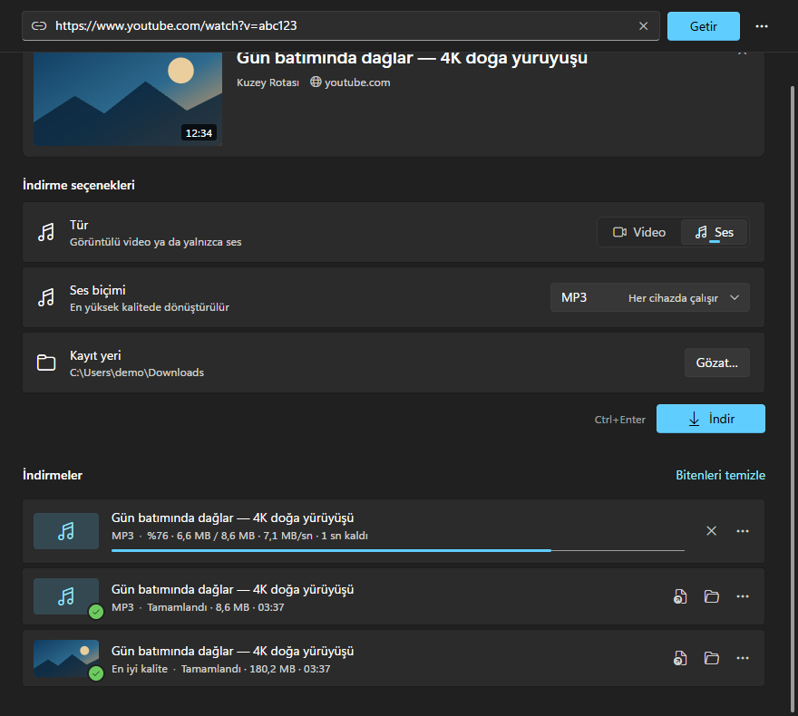
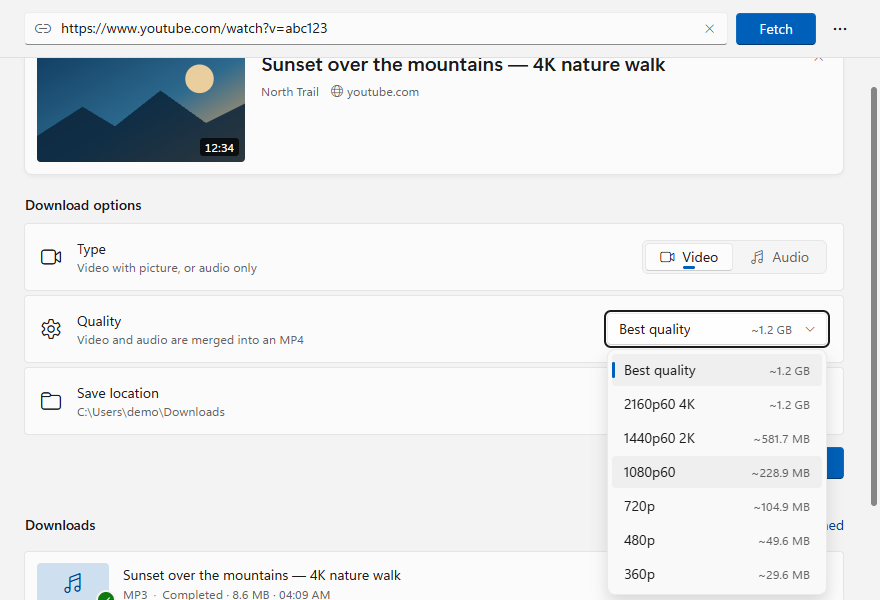

<p align="center">
  
</p>

<h1 align="center">yt-dlp GUI</h1>

<p align="center">
  A lightweight, native-feeling Windows app for <a href="https://github.com/yt-dlp/yt-dlp">yt-dlp</a>.<br>
  Built with Tauri 2 and Svelte 5. The installer is only a few megabytes.
</p>

<p align="center">
  <a href="https://github.com/akcware/ytdlp-gui/releases/latest"></a>
  <a href="LICENSE"></a>
  
</p>

<p align="center">
  
</p>

## Features

- **Paste a link and go.** Title, thumbnail, duration and the available resolutions (with approximate sizes) load as soon as you paste.
- **Video or audio.** Pick a quality (merged into MP4) or audio only (MP3 / M4A). Your choices are remembered.
- **Live progress** with percentage, size, speed and remaining time, plus the merge/convert step.
- **Parallel downloads** with cancel, retry, open and "show in folder". Your download history is kept between launches.
- **Playlists** download in full into `Playlist Title/001 - Title [id].mp4`.
- **No bundled binaries.** yt-dlp and ffmpeg are downloaded on first run into the app's own folder, and yt-dlp updates itself with `yt-dlp -U`. Nothing is installed system-wide.

### Feels like a Windows 11 app

- **Mica** backdrop and your **Windows accent color**. Light and dark themes follow the system, and Windows 10 falls back to the solid Fluent background.
- WinUI 3 colors, typography (Segoe UI Variable) and icons (Segoe Fluent Icons). Controls follow WinUI 3: Settings-style rows, ComboBox, segmented control, InfoBar, ProgressBar and ProgressRing.
- Real **Windows context menus** and system **message boxes**.
- **Taskbar progress**, and a **toast notification** when a download finishes while the window is in the background.
- Remembers window size and position, and never flashes a white window on launch.
- Suggests the link on your clipboard, and accepts links dragged onto the window.
- Browser behaviors are turned off: reload, find, zoom, text selection and the browser context menu.

| Shortcut | Action |
| --- | --- |
| `Ctrl+V` | Paste a link and fetch it |
| `Ctrl+L` | Focus the address box |
| `Ctrl+Enter` | Download |
| `Esc` | Close the current video |
| `Enter` / `Delete` / `Menu` | Open / remove / context menu, on a download in the list |

<p align="center">
  
</p>

> The user interface is currently in Turkish.

## Download

Get the latest installer from **[Releases](https://github.com/akcware/ytdlp-gui/releases/latest)**:

- `yt-dlp-GUI_x.y.z_x64-setup.exe`: recommended. It installs per user and needs no admin rights.
- `yt-dlp-GUI_x.y.z_x64_en-US.msi`: for managed or silent installs.

You need Windows 10 or 11 (x64) with the Microsoft Edge WebView2 Runtime, which comes with Windows 11. The installers are not code-signed yet, so Windows SmartScreen may warn you. Choose **More info → Run anyway**.

## How it works

yt-dlp runs as a separate process, not as a library. That way it can be updated without a new app release.

| What | How |
| --- | --- |
| Metadata | `yt-dlp -J --no-playlist --flat-playlist <url>` |
| Progress | `--newline --progress-template "download:@@P\|%(progress.status)s\|…"`. Each line is parsed in Rust and sent to the UI as an event, throttled to about 8 per second. |
| Final file | `--print "after_move:@@F\|%(filepath)s"` |
| Cancel | `taskkill /T /F` stops yt-dlp together with the ffmpeg it started |
| Binaries | `%LOCALAPPDATA%\com.kadir.ytdlpgui\bin`, downloaded with the `curl.exe` that ships with Windows, and the ffmpeg zip is unpacked with `tar.exe`. The app needs no HTTP or TLS crates. |

Without ffmpeg, video falls back to single-file formats (usually up to 360p on YouTube) and audio is saved as the original M4A. The app tells you when that happens.

## Building from source

Prerequisites (Windows): [Microsoft C++ Build Tools](https://visualstudio.microsoft.com/visual-cpp-build-tools/) with the "Desktop development with C++" workload, [Rust](https://rustup.rs) and [Bun](https://bun.sh). Node.js also works. See the [Tauri prerequisites](https://tauri.app/start/prerequisites/) for details.

```bash
bun install
bun run tauri dev      # run the app
bun run tauri build    # installers in src-tauri/target/release/bundle/
```

If linking fails with `LNK1104: cannot open file …build_script_build….exe`, the project path is too long for the MSVC linker (260-character limit). Move the project to a shorter folder, or set `CARGO_TARGET_DIR` to a short path.

### Working on the UI without Rust

```bash
bun run dev
```

Open <http://localhost:1420>. Outside Tauri, `src/lib/mock.ts` provides a fake backend. It is loaded only in development and never ships in a build. Try these:

- A URL containing `fail` shows a failed download.
- A URL containing `broken` shows a failed metadata fetch.
- A URL containing `playlist` shows the playlist view.
- `?setup=1` opens the first-run screen, and `?noffmpeg=1` shows the ffmpeg warning.

Native menus can't open in a plain browser, so a Fluent menu with the same entries is shown instead.

## Project structure

```
src/
  routes/+layout.svelte   applies Mica/accent, shows the window, disables browser shortcuts
  routes/+page.svelte     command bar, notices, empty state, download list, shortcuts, drag & drop
  lib/styles/fluent.css   WinUI 3 design tokens (light/dark) and base controls
  lib/components/         ComboBox, Segmented, InfoBar, ProgressBar/Ring, DownloadItem, VideoPanel, Onboarding…
  lib/state/              settings / tools / downloads stores (Svelte 5 runes, persisted)
  lib/native.svelte.ts    native menus, clipboard, notifications, taskbar progress
  lib/api.ts              typed wrappers for the Rust commands, formatting helpers
  lib/mock.ts             fake backend for UI work in a browser
src-tauri/src/
  lib.rs                  app setup, plugins, commands, kills running downloads on exit
  appearance.rs           Mica backdrop and the Windows accent color palette
  tools.rs                downloads and updates yt-dlp / ffmpeg
  ytdlp.rs                metadata (-J), downloads, progress parsing, cancel
  process.rs              spawning without console windows, killing process trees
app-icon.svg              icon source (regenerate with `bunx tauri icon app-icon.svg`)
```

## Credits and disclaimer

- [yt-dlp](https://github.com/yt-dlp/yt-dlp) (Unlicense) does all the actual work. This project is not affiliated with it.
- ffmpeg builds come from [yt-dlp/FFmpeg-Builds](https://github.com/yt-dlp/FFmpeg-Builds) (GPL). They are downloaded at runtime, not redistributed with this app.
- Only download content you have the right to download, and respect each site's terms of service.

## License

[MIT](LICENSE) © 2026 Aşkın Kadir Çekim
